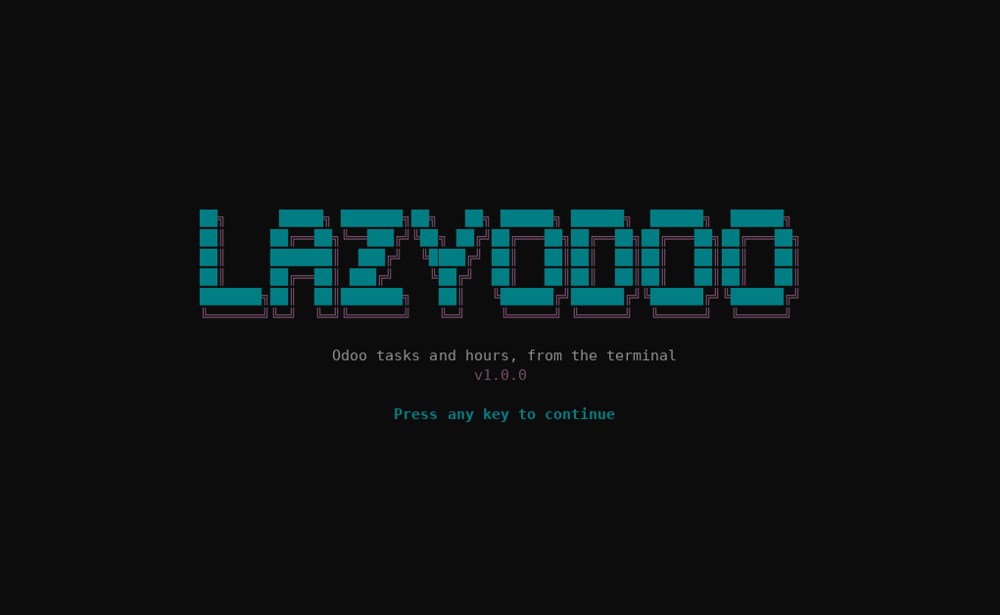

<div align="center">

**English** · [Español](docs/readme/README_es.md) · [Português (Brasil)](docs/readme/README_pt-BR.md) · [简体中文](docs/readme/README_zh.md)

# lazyodoo

### Odoo tasks and timesheets from the terminal, in the style of [lazygit](https://github.com/jesseduffield/lazygit) and [lazydocker](https://github.com/jesseduffield/lazydocker).

**A Rust TUI (ratatui) that talks straight to Odoo over JSON-RPC. No API in between: every person signs in with their own Odoo user, so Odoo decides the permissions.**

[](#requirements)
[](#development)
[](#how-it-works)
[](#languages)

[Showcase](#showcase) · [Quick start](#quick-start) · [Screen](#screen) · [Controls](#controls) · [How it works](#how-it-works) · [If something fails](#if-something-fails) · [Local data](#local-data) · [Languages](#languages) · [FAQ](#faq) · [Development](#development)

</div>

> [!NOTE]
> lazyodoo talks directly to `https://<odoo>/jsonrpc`. You need the name of the Odoo database and your user with an Odoo API key.

---

With lazyodoo you see **only what is assigned to you and still open**: your tasks and the projects they belong to. You can log hours on a task, create tasks, change assignees, stage, priority and other data, and **complete tasks** so they leave the list. On the first start it asks for your access details and **checks them against Odoo before saving them**.

## Showcase

<p align="center"></p>

## Quick start

### Requirements

- An Odoo 17 (Community or Enterprise) with the Project and Timesheets apps, no extra modules.
- The name of the Odoo database.
- An internal Odoo user (portal users are rejected) and its API key. A password also works, unless the user has 2FA.
- To build: stable Rust with the 2024 edition (1.85 or newer; tested with 1.97.1) and a C compiler (TLS cryptography needs it). OpenSSL is not needed: TLS uses rustls.

### Installation

Clone the repository and, from its folder:

```sh
cargo install --path . --locked
```

The binary ends up in `~/.cargo/bin/lazyodoo`. If you prefer not to install it, `cargo build --release` leaves it in `target/release/lazyodoo`. `lazyodoo --version` prints the version.

### Running

```sh
lazyodoo
```

On the first start it asks for your **language** (English, Spanish, Portuguese or Chinese) and then opens the access form:

| Field | What to enter |
| --- | --- |
| Odoo URL | Just the origin, for example `https://odoo.example.com` (no path). `https` is required, except for `localhost`. |
| Database | Name of the Odoo database |
| Odoo user | Your login, usually your email (`name@example.com`) |
| Odoo API key | Your API key (recommended over the password) |

`Enter` moves to the next field and, on the last one, checks against Odoo and saves. If something is wrong, the message tells you what to fix and nothing is saved ([see errors](#if-something-fails)). If all is well, you go straight to the main screen; later starts do not ask again.

## Screen

On start the lazyodoo banner shows; continue with any key (or wait a moment). The interface uses the Odoo palette over your terminal background: with truecolor (`COLORTERM=truecolor`, or Windows Terminal) the colors are exact, otherwise the closest 256-color approximation is used.

```text
 lazyodoo  name@example.com @ odoo.example.com · mine · project: all projects
╭ [1] Projects ───────╮╭ Detail ──────────────────────────────────╮
│● All                ││#11 Migrate database                      │
│  Alpha              ││                                          │
╰─────────────────────╯│Project:   Alpha                          │
╭ [2] Tasks ──────────╮│Stage:     In progress                    │
│#11 Migrate database ││Assignees: First Last                     │
│                     ││Hours:     8.0 allocated · 2.0 logged · … │
╰─────────────────────╯│                                          │
╭ [3] Hours this week ╮│Move the database to v17                  │
│                     ││                                          │
╰─────────────────────╯╰──────────────────────────────────────────╯
 j/k move · t hours · n new · e edit · a assign · s stage · …
```

- **Projects.** Only the projects where you have open assigned tasks (with `m` it becomes all of them). `Enter` applies one as a filter for tasks and hours. «All» removes it.
- **Tasks.** List on the left and detail on the right. By default only what is assigned to you and not finished: when you complete a task it disappears and the list moves up.
- **Hours.** The timesheet lines of the current week (since Monday), with the total in the title.
- Each panel loads on its own: if one fails, the error shows in that panel and the others keep working.

## Controls

| Key | Action |
| --- | --- |
| `1` `2` `3` · `Tab` `Shift+Tab` | switch panel |
| `j` `k` · `↑` `↓` · `g` `G` | move the selection, go to the start or the end |
| `J` `K` · `PgDn` `PgUp` | scroll the detail |
| `Enter` | in Projects: apply the project as a filter |
| `m` | toggle «mine» and «all» (both show only what is open) |
| `/` · `Esc` | filter the panel by text · clear the filter |
| `r` | refresh everything (the cursor stays on the same record) |
| `l` | switch language (it cycles through the four and is saved) |
| `q` · `Ctrl+C` | quit |

In Tasks, on the selected task:

| Key | Action |
| --- | --- |
| `n` | create a task |
| `e` | edit in a form |
| `a` | change assignees (several) and save on pick |
| `s` | change stage and save on pick |
| `p` | change priority and save on pick |
| `t` | log hours |
| `c` | complete the task (asks for confirmation) |

Forms take the whole screen. Text fields have a cursor (`←` `→` `Home` `End` `Del`). Inside forms:

| Key | Action |
| --- | --- |
| `Tab` `Shift+Tab` · `↑` `↓` | move between fields |
| `Enter` | open the field's picker, or go to the next one; on the last text field, send |
| `Ctrl+S` | send from any field |
| `Backspace` | delete text or clear a picker's selection (picker fields show `▾`) |
| `Esc` | cancel (while sending it cannot be cancelled) |

In pickers, typing filters the list, `Enter` picks (or toggles in multi-select ones) and `Esc` closes.

## How it works

- **Connection.** Every request is a JSON-RPC `POST` to `<url>/jsonrpc`. It first authenticates with `common.authenticate` and then uses `execute_kw` with your `uid` and your key.
- **Permissions.** Only those of your Odoo user: lazyodoo neither adds nor removes any. Portal users (`share`) are rejected.
- **Who you are.** By the `uid` of your session, not by comparing emails: «mine» always works. Your employee (`hr.employee`) is looked up from your user and filters your hours in Odoo; if there is none, hours are filtered by name.
- **What «open» means.** Tasks whose `state` is neither `1_done` nor `1_canceled`. If your Odoo does not have that field (checked with `fields_get`), `is_closed` is used and, if that is missing too, nothing is filtered. Completing a task writes `state = 1_done` (Done) after confirmation; the confirmation shows the hours logged on the task and its subtasks, as they are in the list (if you logged them somewhere else, refresh with `r`).
- **What it reads and writes.** Only these models and fields, with no generic access to Odoo:

| Purpose | Odoo model |
| --- | --- |
| Users, projects, stages and tags | `res.users`, `project.project`, `project.task.type`, `project.tags` |
| Tasks (read, create, edit) | `project.task` |
| Hours (read, create) | `account.analytic.line` |
| Your employee (to filter your hours) | `hr.employee` |

- **Editing.** Only what changed is sent; clearing an optional field empties it in Odoo. If the form has no changes, no request is made.
- **Validation.** Before sending, the limits of the form and of `routes` apply: name of 1 to 256 characters, hours greater than 0 and up to 24, date `DD-MM-YY`, non-negative allocated hours, valid ids and only fields from the allowed list.
- **Dates.** They are typed as `DD-MM-YY`: only digits go in, the dashes are added for you and an impossible date cannot be built (month above 12, February 31…). For hours, future dates and years later than the current one are not accepted; the deadline has no year limit. You can also paste `05/11/2026`. The deadline is asked in your local time and stored in UTC, as Odoo expects.
- **Start time.** The hours form asks for date, start time (`HH:MM`, colon added for you), hours and description, so you can log what you did yesterday at 10:00 rather than at the time you log it. The start time is stored in the `date_time` field of the timesheet lines and shown in the Hours panel and in the detail. It only appears if your Odoo has that field (detected with `fields_get`); otherwise the form says so and does not ask for it. Neither the date nor the start time can be in the future.
- **Finish task.** The hours form ends with `Finish task? [ ]` (toggled with `Space`). If you tick it, the hours are logged first and then the task is completed (Done), just like with `c`. If the hours are saved but the task cannot be finished, the message says so and `Enter` retries only the finishing.
- **Writes.** They are never retried on their own. On a timeout or a 5xx error, the message warns that it **may have been saved** and sends you to check the panel before retrying.
- **Security.** `https` is required (except for `localhost`), redirects are not followed and text coming from Odoo is stripped of control characters before being drawn. Secrets are not shown on screen and do not appear in error messages.

## If something fails

Messages appear in the language you chose. These are the English ones:

| Message | Cause and fix |
| --- | --- |
| «Invalid Odoo user, key or database» | Check the login, the API key and the database name. |
| «Odoo answered 502: … database "x" does not exist» | The database name is wrong. |
| «Access denied: Only internal users can use lazyodoo» | Your user is a portal user. An internal user is needed. |
| «Access denied: …» (with Odoo's text) | Your user lacks permission for that operation in Odoo. |
| «Odoo answered 400: …» | Odoo rejected the data; the message is Odoo's. Fix the form and send again. |
| «No response in 15s» / «Could not connect» | Check the URL and your connection. |
| «The URL answered, but it does not look like Odoo» | The domain is not Odoo's, the `/jsonrpc` path is blocked or a proxy cut the request. |
| «… has permissions 644: other users could read the secrets» | Run the `chmod 600` the message gives. |
| «Invalid config in … Delete the file» | The configuration file is incomplete or damaged. Delete it and enter the details again. |
| «Could not locate your user» / «Could not read your user» | Reading your user failed: every record is shown. Refresh with `r` or check the connection. |

## Local data

lazyodoo keeps two small files in its configuration folder:

| File | Contents |
| --- | --- |
| `config.toml` | Your Odoo access details, with your credentials **in plain text** |
| `settings.toml` | The language you chose (not secret) |

| System | Folder |
| --- | --- |
| Linux | `~/.config/lazyodoo/` |
| Windows | `%APPDATA%\lazyodoo\` |
| macOS | `~/Library/Application Support/lazyodoo/` |

On Linux and macOS the files are created with `0600` permissions (and the folder with `0700`), and the app refuses to start if `config.toml` is more open. On Windows permissions are not adjusted: protect the folder with your user's permissions. To change server or user, delete `config.toml` and the next start asks for the details again. To pick the language again, delete `settings.toml` (or press `l`).

## Languages

English, Spanish (`es`), Portuguese (`pt`) and Chinese (`zh`). On the first start, after the banner, lazyodoo asks which one to use (`↑` `↓` and `Enter`, or `1`–`4`); the choice is saved in `settings.toml`. In the main screen, `l` switches to the next language and saves it too.

Everything lazyodoo writes is translated: panels, forms, hints and messages. What comes from Odoo (names of projects, tasks and stages, and the texts of errors that Odoo itself writes) is shown as Odoo sends it.

## FAQ

<details>
<summary><strong>Does it save my Odoo key?</strong></summary>

Yes, in plain text in the configuration file, protected with `0600` permissions. Use an Odoo API key instead of your password: it can be revoked without changing your account password, and it works even if you have 2FA.

</details>

<details>
<summary><strong>Do I see other people's hours, or not see mine?</strong></summary>

The «mine» hours are filtered in Odoo by your employee (the `hr.employee` linked to your user). If your user has no employee, they are filtered by an employee name equal to your user's; if that does not match either, a notice appears and `m` shows all of them.

</details>

<details>
<summary><strong>Can it delete data?</strong></summary>

No. It only reads, creates and modifies.

</details>

## Development

```sh
cargo build
cargo test            # needs no network or Odoo: it uses a fake Odoo on localhost
cargo clippy --all-targets -- -D warnings
cargo fmt --check
```

```text
src/
  main.rs         Terminal, startup and event loop
  config.rs       Configuration, URL validation, saving with 0600 permissions and the language setting
  api.rs          Facade the app uses (get/post/put) and the errors
  odoo.rs         JSON-RPC session: authentication, execute_kw and Odoo errors
  routes.rs       Routes, domains, fields and serializers
  wizard.rs       First-start form
  lang_select.rs  Language picker for the first start
  i18n.rs         Languages and text lookup (tr/trf)
  ui_strings.rs   The interface texts in the four languages
  app.rs          State, keys and requests of the main screen
  ui.rs           Drawing of the panels
  theme.rs        Odoo palette (purple #714B67, teal #017E84, gray #8F8F8F)
  banner.rs       Start banner
  models.rs       Models and text of lists and detail
  inputs.rs       Text editing with cursor, line wrapping and the DD-MM-YY date mask
  hours_form.rs   Hours logging form
  create_form.rs  Create and edit forms, with pickers
  testutil.rs     Fake Odoo for the tests (tests only)
```

To add or change an interface text, write it in English inside `tr("…")` (or `trf("…", &[…])` for `{name}` placeholders) and add its row with the four languages to `src/ui_strings.rs`. A test fails if a text is missing in any language, has different placeholders, or is no longer used.

## Known limits

- It does not include leads or contacts, nor editing or deleting timesheet lines, nor editing the description of tasks.
- Task stages are listed only for the project, if your Odoo relates them (`project_ids`); otherwise all are listed. Odoo may reject a stage that does not apply, and the error is shown in the form.
- The start time uses the `date_time` field. If in your Odoo the time of timesheet lines lives in another field (you can see it with developer mode, hovering over the field), the form will not ask for it: the technical name is needed to add it.
- It was tried on 130×36 terminals. On smaller terminals the layout is cropped, but it does not fail.
- Tested on Linux and only against a fake Odoo. Not tested on Windows or macOS, nor against a real Odoo 17.
