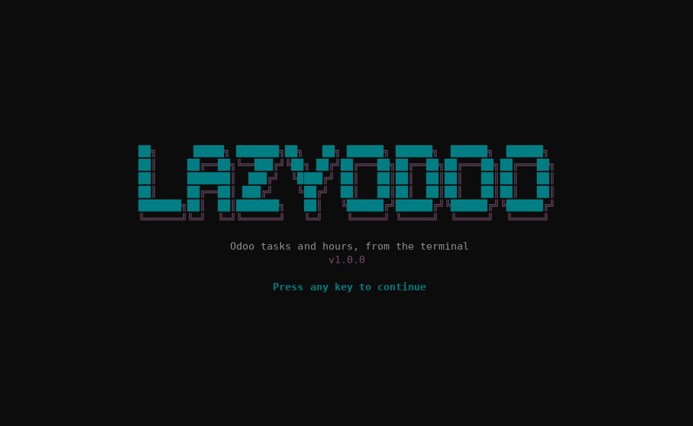

<div align="center">

[English](../../README.md) · **Español** · [Português (Brasil)](README_pt-BR.md) · [简体中文](README_zh.md)

# lazyodoo

### Tareas y horas de Odoo desde la terminal, al estilo [lazygit](https://github.com/jesseduffield/lazygit) y [lazydocker](https://github.com/jesseduffield/lazydocker).

**Una TUI en Rust (ratatui) que se conecta directo a Odoo por JSON-RPC. No necesita ninguna API de por medio: cada usuario entra con su propio usuario de Odoo, así que los permisos los decide Odoo.**

[](#requisitos)
[](#desarrollo)
[](#cómo-funciona)
[](#idiomas)

[Demo](#demo) · [Inicio rápido](#inicio-rápido) · [Pantalla](#pantalla) · [Controles](#controles) · [Cómo funciona](#cómo-funciona) · [Si algo falla](#si-algo-falla) · [Datos locales](#datos-locales) · [Idiomas](#idiomas) · [Preguntas frecuentes](#preguntas-frecuentes) · [Desarrollo](#desarrollo)

</div>

> [!NOTE]
> lazyodoo habla directamente con `https://<odoo>/jsonrpc`. Necesitás el nombre de la base de datos y tu usuario con API key de Odoo.

---

Con lazyodoo ves **solo lo que tenés asignado y sigue abierto**: tus tareas y los proyectos donde las tenés. Podés cargar horas sobre una tarea, crear tareas, cambiar asignación, estado, prioridad y demás datos, y **completar tareas** para que salgan de la lista. En el primer arranque te pide los datos de acceso y **los valida contra Odoo antes de guardarlos**.

## Demo

<p align="center"></p>

## Inicio rápido

### Requisitos

- Un Odoo 17 (Community o Enterprise) con las apps Proyecto y Hojas de horas, sin módulos extra.
- El nombre de la base de datos de Odoo.
- Un usuario interno de Odoo (los usuarios portal se rechazan) y su API key. Con contraseña también anda, salvo que el usuario tenga 2FA.
- Para compilar: Rust estable con edición 2024 (1.85 o más; probado con 1.97.1) y un compilador de C (lo necesita la criptografía TLS). No hace falta OpenSSL: TLS va con rustls.

### Instalación

Clonás el repositorio y, desde su carpeta:

```sh
cargo install --path . --locked
```

El binario queda en `~/.cargo/bin/lazyodoo`. Si preferís no instalarlo, `cargo build --release` lo deja en `target/release/lazyodoo`. `lazyodoo --version` muestra la versión.

### Ejecución

```sh
lazyodoo
```

En el primer arranque te pregunta el **idioma** (inglés, español, portugués o chino) y después se abre el formulario de acceso:

| Campo | Qué poner |
| --- | --- |
| URL de Odoo | Solo el origen, por ejemplo `https://odoo.example.com` (sin ruta). Se exige `https`, salvo para `localhost`. |
| Base de datos | Nombre de la base de Odoo |
| Usuario de Odoo | Tu login, normalmente tu email (`nombre@example.com`) |
| API key de Odoo | Tu API key (recomendada en lugar de la contraseña) |

`Enter` pasa al campo siguiente y, en el último, valida contra Odoo y guarda. Si algo no anda, el mensaje te dice qué corregir y no se guarda nada ([ver errores](#si-algo-falla)). Si todo anda, entrás directo a la pantalla principal; en los próximos arranques no se vuelve a pedir.

## Pantalla

Al abrir se muestra el banner de lazyodoo; seguí con cualquier tecla (o esperá un momento). La interfaz usa la paleta de Odoo sobre el fondo de tu terminal: con truecolor (`COLORTERM=truecolor`, o Windows Terminal) los colores son exactos y, si no, se usa la aproximación más cercana de 256 colores.

```text
 lazyodoo  nombre@example.com @ odoo.example.com · mías · proyecto: todos
╭ [1] Proyectos ──────╮╭ Detalle ─────────────────────────────────╮
│● Todos              ││#11 Migrar base                           │
│  Alfa               ││                                          │
╰─────────────────────╯│Proyecto:  Alfa                           │
╭ [2] Tareas ─────────╮│Estado:    En ejecución                   │
│#11 Migrar base      ││Asignados: Nombre Apellido                │
│                     ││Horas:     8.0 asignadas · 2.0 cargadas   │
╰─────────────────────╯│                                          │
╭ [3] Horas semana ───╮│Pasar la base a v17                       │
│                     ││                                          │
╰─────────────────────╯╰──────────────────────────────────────────╯
 j/k mover · t horas · n nueva · e editar · a asignar · s estado · …
```

- **Proyectos.** Solo los proyectos donde tenés tareas abiertas asignadas (con `m` pasan a ser todos). Con `Enter` aplicás uno como filtro de tareas y horas. «Todos» lo saca.
- **Tareas.** Lista a la izquierda y detalle a la derecha. Por defecto solo lo asignado a vos y no finalizado: al completar una tarea, desaparece y la lista baja.
- **Horas.** Las líneas de la semana en curso (desde el lunes), con el total en el título.
- Cada panel carga por separado: si uno falla, el error aparece en ese panel y los demás siguen funcionando.

## Controles

| Tecla | Acción |
| --- | --- |
| `1` `2` `3` · `Tab` `Shift+Tab` | cambiar de panel |
| `j` `k` · `↑` `↓` · `g` `G` | mover la selección, ir al principio o al final |
| `J` `K` · `PgDn` `PgUp` | desplazar el detalle |
| `Enter` | en Proyectos: aplicar el proyecto como filtro |
| `m` | alternar «mías» y «todas» (las dos muestran solo lo abierto) |
| `/` · `Esc` | filtrar el panel por texto · limpiar el filtro |
| `r` | refrescar todo (el cursor se queda sobre el mismo registro) |
| `l` | cambiar de idioma (recorre los cuatro y queda guardado) |
| `q` · `Ctrl+C` | salir |

En Tareas, sobre la tarea seleccionada:

| Tecla | Acción |
| --- | --- |
| `n` | crear una tarea |
| `e` | editar en un formulario |
| `a` | cambiar asignados (varios) y guardar al elegir |
| `s` | cambiar estado y guardar al elegir |
| `p` | cambiar prioridad y guardar al elegir |
| `t` | cargar horas |
| `c` | completar la tarea (pide confirmación) |

Los formularios ocupan toda la pantalla. Los campos de texto tienen cursor (`←` `→` `Inicio` `Fin` `Supr`). Dentro de los formularios:

| Tecla | Acción |
| --- | --- |
| `Tab` `Shift+Tab` · `↑` `↓` | moverse entre campos |
| `Enter` | abrir el selector del campo, o pasar al siguiente; en el último campo de texto, enviar |
| `Ctrl+S` | enviar desde cualquier campo |
| `Backspace` | borrar texto o limpiar la selección de un selector (los campos selector llevan `▾`) |
| `Esc` | cancelar (mientras envía no se puede cancelar) |

En los selectores, escribir filtra la lista, `Enter` elige (o marca y desmarca en los de selección múltiple) y `Esc` cierra.

## Cómo funciona

- **Conexión.** Cada pedido es un `POST` JSON-RPC a `<url>/jsonrpc`. Primero se autentica con `common.authenticate` y después usa `execute_kw` con tu `uid` y tu clave.
- **Permisos.** Son solo los de tu usuario en Odoo: lazyodoo no agrega ni quita ninguno. Se rechazan los usuarios portal (`share`).
- **Quién sos.** Por el `uid` de tu sesión, no por comparar emails: «mías» siempre funciona. Tu empleado (`hr.employee`) se busca por tu usuario y filtra tus horas en Odoo; si no existe, las horas se filtran por nombre.
- **Qué es «abierto».** Las tareas con `state` distinto de `1_done` y `1_canceled`. Si tu Odoo no tiene ese campo (se consulta con `fields_get`), se usa `is_closed` y, si tampoco está, no se filtra. Completar una tarea escribe `state = 1_done` (Hecha), previa confirmación; la confirmación muestra las horas cargadas en la tarea y sus subtareas, tal como están en la lista (si las cargaste por otro lado, refrescá con `r`).
- **Qué lee y escribe.** Solo estos modelos y campos, sin acceso genérico a Odoo:

| Para qué | Modelo de Odoo |
| --- | --- |
| Usuarios, proyectos, estados y tags | `res.users`, `project.project`, `project.task.type`, `project.tags` |
| Tareas (leer, crear, editar) | `project.task` |
| Horas (leer, crear) | `account.analytic.line` |
| Tu empleado (para filtrar tus horas) | `hr.employee` |

- **Edición.** Se manda solo lo que cambió; limpiar un campo opcional lo vacía en Odoo. Si el formulario no tiene cambios, no hace ningún pedido.
- **Validación.** Antes de enviar se aplican los límites del formulario y de `routes`: nombre de 1 a 256 caracteres, horas mayores a 0 y hasta 24, fecha `DD-MM-AA`, horas asignadas no negativas, ids válidos y solo campos de la lista permitida.
- **Fechas.** Se escriben como `DD-MM-AA`: solo entran dígitos, los guiones se ponen solos y no se puede armar una fecha imposible (mes mayor a 12, 31 de febrero…). En las horas no se admiten fechas futuras ni un año mayor al actual; el deadline no tiene tope de año. También se puede pegar `05/11/2026`. El deadline se pide en tu hora local y se guarda en UTC, como espera Odoo.
- **Hora de inicio.** El formulario de horas pide fecha, hora de inicio (`HH:MM`, con los dos puntos automáticos), horas y descripción: así podés cargar lo que hiciste ayer a las 10:00 y no con la hora en que lo cargás. La hora de inicio se guarda en el campo `date_time` de las líneas de horas y se muestra en el panel Horas y en el detalle. Solo aparece si tu Odoo tiene ese campo (se detecta con `fields_get`); si no, el formulario lo avisa y no la pide. La fecha y la hora de inicio no pueden ser futuras.
- **Finalizar tarea.** El formulario de horas termina con `Finalizar tarea? [ ]` (se marca con `Espacio`). Si lo marcás, primero se cargan las horas y después la tarea se completa (estado Hecha), igual que con `c`. Si las horas se guardan pero no se puede finalizar, el mensaje lo dice y `Enter` reintenta solo la finalización.
- **Escrituras.** Nunca se reintentan solas. Si hay un timeout o un error 5xx, el mensaje avisa que **puede haberse guardado** y te manda a revisar el panel antes de reintentar.
- **Seguridad.** Se exige `https` (salvo `localhost`), no se siguen redirects y el texto que viene de Odoo se limpia de caracteres de control antes de dibujarse. Los secretos no se muestran en pantalla ni aparecen en los mensajes de error.

## Si algo falla

Los mensajes salen en el idioma que elegiste. Estos son los del español:

| Mensaje | Causa y solución |
| --- | --- |
| «Usuario, clave o base de datos de Odoo inválidos» | Revisá el login, la API key y el nombre de la base. |
| «Odoo respondió 502: … database "x" does not exist» | El nombre de la base de datos está mal. |
| «Acceso denegado: Solo los usuarios internos pueden usar lazyodoo» | Tu usuario es portal. Hace falta un usuario interno. |
| «Acceso denegado: …» (con el texto de Odoo) | Tu usuario no tiene permiso para esa operación en Odoo. |
| «Odoo respondió 400: …» | Odoo rechazó los datos; el mensaje es el de Odoo. Corregí el formulario y reenviá. |
| «No hubo respuesta en 15s» / «No se pudo conectar» | Revisá la URL y tu conexión. |
| «La URL respondió, pero no parece ser Odoo» | El dominio no es el de Odoo, la ruta `/jsonrpc` está bloqueada o un proxy cortó el pedido. |
| «…tiene permisos 644: otros usuarios podrían leer los secretos» | Ejecutá el `chmod 600` que indica el mensaje. |
| «Config inválida … Borrá el archivo» | El archivo de configuración está incompleto o dañado. Borralo y cargá los datos de nuevo. |
| «No pude ubicar tu usuario» / «No pude leer tu usuario» | Falló la lectura de tu usuario: se muestran todos los registros. Refrescá con `r` o revisá la conexión. |

## Datos locales

lazyodoo guarda dos archivos chicos en su carpeta de configuración:

| Archivo | Contenido |
| --- | --- |
| `config.toml` | Tus datos de acceso a Odoo, con tus credenciales **en texto plano** |
| `settings.toml` | El idioma que elegiste (no es secreto) |

| Sistema | Carpeta |
| --- | --- |
| Linux | `~/.config/lazyodoo/` |
| Windows | `%APPDATA%\lazyodoo\` |
| macOS | `~/Library/Application Support/lazyodoo/` |

En Linux y macOS los archivos se crean con permisos `0600` (y la carpeta con `0700`), y la app se niega a arrancar si `config.toml` está más abierto. En Windows no se ajustan permisos: protegé la carpeta con los permisos de tu usuario. Para cambiar de servidor o de usuario, borrá `config.toml` y el próximo arranque vuelve a pedir los datos. Para elegir el idioma de nuevo, borrá `settings.toml` (o apretá `l`).

## Idiomas

Inglés, español (`es`), portugués (`pt`) y chino (`zh`). En el primer arranque, después del banner, lazyodoo te pregunta cuál usar (`↑` `↓` y `Enter`, o `1`–`4`); la elección queda guardada en `settings.toml`. En la pantalla principal, `l` pasa al idioma siguiente y también lo guarda.

Todo lo que escribe lazyodoo está traducido: paneles, formularios, ayudas y mensajes. Lo que viene de Odoo (nombres de proyectos, tareas y estados, y los textos de errores que escribe el propio Odoo) se muestra como lo manda Odoo.

## Preguntas frecuentes

<details>
<summary><strong>¿Guarda mi clave de Odoo?</strong></summary>

Sí, en texto plano en el archivo de configuración, protegido con permisos `0600`. Usá una API key de Odoo en lugar de tu contraseña: se puede revocar sin cambiar la clave de tu cuenta, y funciona aunque tengas 2FA.

</details>

<details>
<summary><strong>¿Veo las horas de otras personas, o no veo mis horas?</strong></summary>

Las horas «mías» se filtran en Odoo por tu empleado (el `hr.employee` vinculado a tu usuario). Si tu usuario no tiene empleado, se filtran por nombre de empleado igual al de tu usuario; si tampoco coincide, aparece un aviso y `m` muestra todas.

</details>

<details>
<summary><strong>¿Puede borrar datos?</strong></summary>

No. Solo lee, crea y modifica.

</details>

## Desarrollo

```sh
cargo build
cargo test            # no necesita red ni Odoo: usa un Odoo simulado en localhost
cargo clippy --all-targets -- -D warnings
cargo fmt --check
```

```text
src/
  main.rs         Terminal, arranque y ciclo de eventos
  config.rs       Configuración, validación de la URL, guardado con permisos 0600 y el idioma elegido
  api.rs          Fachada que usa la app (get/post/put) y los errores
  odoo.rs         Sesión JSON-RPC: autenticación, execute_kw y errores de Odoo
  routes.rs       Rutas, dominios, campos y serializers
  wizard.rs       Formulario de primer arranque
  lang_select.rs  Selector de idioma del primer arranque
  i18n.rs         Idiomas y búsqueda de textos (tr/trf)
  ui_strings.rs   Los textos de la interfaz en los cuatro idiomas
  app.rs          Estado, teclas y pedidos de la pantalla principal
  ui.rs           Dibujo de los paneles
  theme.rs        Paleta de Odoo (violeta #714B67, verde azulado #017E84, gris #8F8F8F)
  banner.rs       Banner de inicio
  models.rs       Modelos y texto de listas y detalle
  inputs.rs       Edición de texto con cursor, ajuste de línea y máscara de fecha DD-MM-AA
  hours_form.rs   Formulario de carga de horas
  create_form.rs  Formularios de alta y edición, con selectores
  testutil.rs     Odoo simulado para los tests (solo en tests)
```

Para agregar o cambiar un texto de la interfaz, escribilo en inglés dentro de `tr("…")` (o `trf("…", &[…])` si lleva `{nombre}`) y sumá su fila con los cuatro idiomas en `src/ui_strings.rs`. Un test falla si a un texto le falta un idioma, si los `{nombre}` no coinciden o si ya no se usa.

## Límites conocidos

- No incluye leads ni contactos, ni editar o borrar líneas de horas, ni editar la descripción de las tareas.
- Los estados de tarea se listan solo los del proyecto, si tu Odoo los relaciona (`project_ids`); si no, se listan todos. Odoo puede rechazar un estado que no corresponda, y el error se muestra en el formulario.
- La hora de inicio usa el campo `date_time`. Si en tu Odoo la hora de las líneas de horas vive en otro campo (se puede ver con el modo desarrollador, pasando el mouse sobre el campo), el formulario no la va a pedir: hay que indicar el nombre técnico para sumarlo.
- Se probó con terminales de 130×36. En terminales más chicas el diseño se recorta, pero no falla.
- Probado en Linux y solo contra un Odoo simulado. No se probó en Windows ni en macOS, ni contra un Odoo 17 real.
