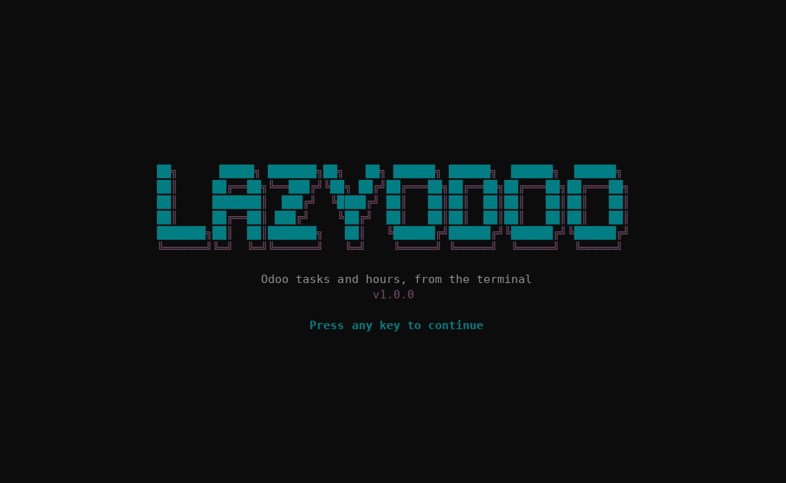

<div align="center">

[English](../../README.md) · [Español](README_es.md) · **Português (Brasil)** · [简体中文](README_zh.md)

# lazyodoo

### Tarefas e horas do Odoo direto do terminal, no estilo do [lazygit](https://github.com/jesseduffield/lazygit) e do [lazydocker](https://github.com/jesseduffield/lazydocker).

**Uma TUI em Rust (ratatui) que conversa direto com o Odoo por JSON-RPC. Não precisa de nenhuma API no meio: cada pessoa entra com o próprio usuário do Odoo, então quem decide as permissões é o Odoo.**

[](#requisitos)
[](#desenvolvimento)
[](#como-funciona)
[](#idiomas)

[Demonstração](#demonstração) · [Início rápido](#início-rápido) · [Tela](#tela) · [Controles](#controles) · [Como funciona](#como-funciona) · [Se algo falhar](#se-algo-falhar) · [Dados locais](#dados-locais) · [Idiomas](#idiomas) · [Perguntas frequentes](#perguntas-frequentes) · [Desenvolvimento](#desenvolvimento)

</div>

> [!NOTE]
> O lazyodoo conversa direto com `https://<odoo>/jsonrpc`. Você precisa do nome do banco de dados do Odoo e do seu usuário com uma API key do Odoo.

---

Com o lazyodoo você vê **só o que está atribuído a você e ainda está aberto**: as suas tarefas e os projetos em que elas estão. Dá para lançar horas em uma tarefa, criar tarefas, mudar responsáveis, etapa, prioridade e outros dados, e **concluir tarefas** para que saiam da lista. Na primeira execução ele pede os dados de acesso e **valida no Odoo antes de salvá-los**.

## Demonstração

<p align="center"></p>

## Início rápido

### Requisitos

- Um Odoo 17 (Community ou Enterprise) com os apps Projeto e Planilhas de horas, sem módulos extras.
- O nome do banco de dados do Odoo.
- Um usuário interno do Odoo (usuários do portal são rejeitados) e a API key dele. Com senha também funciona, a não ser que o usuário tenha 2FA.
- Para compilar: Rust estável com a edição 2024 (1.85 ou mais; testado com 1.97.1) e um compilador de C (a criptografia TLS precisa dele). Não precisa de OpenSSL: o TLS usa rustls.

### Instalação

Clone o repositório e, dentro da pasta dele:

```sh
cargo install --path . --locked
```

O binário fica em `~/.cargo/bin/lazyodoo`. Se preferir não instalar, `cargo build --release` o deixa em `target/release/lazyodoo`. `lazyodoo --version` mostra a versão.

### Execução

```sh
lazyodoo
```

Na primeira execução ele pergunta o **idioma** (inglês, espanhol, português ou chinês) e depois abre o formulário de acesso:

| Campo | O que preencher |
| --- | --- |
| URL do Odoo | Só a origem, por exemplo `https://odoo.example.com` (sem caminho). `https` é obrigatório, exceto para `localhost`. |
| Banco de dados | Nome do banco de dados do Odoo |
| Usuário do Odoo | Seu login, normalmente seu e-mail (`nome@example.com`) |
| API key do Odoo | Sua API key (recomendada no lugar da senha) |

`Enter` passa para o campo seguinte e, no último, valida no Odoo e salva. Se algo estiver errado, a mensagem diz o que corrigir e nada é salvo ([veja os erros](#se-algo-falhar)). Se tudo der certo, você entra direto na tela principal; nas próximas execuções os dados não são pedidos de novo.

## Tela

Ao abrir aparece o banner do lazyodoo; continue com qualquer tecla (ou espere um instante). A interface usa a paleta do Odoo sobre o fundo do seu terminal: com truecolor (`COLORTERM=truecolor`, ou Windows Terminal) as cores são exatas e, sem ele, usa-se a aproximação mais próxima de 256 cores.

```text
 lazyodoo  nome@example.com @ odoo.example.com · minhas · projeto: todos
╭ [1] Projetos ───────╮╭ Detalhe ─────────────────────────────────╮
│● Todos              ││#11 Migrar banco                          │
│  Alfa               ││                                          │
╰─────────────────────╯│Projeto:      Alfa                        │
╭ [2] Tarefas ────────╮│Etapa:        Em andamento                │
│#11 Migrar banco     ││Responsáveis: Nome Sobrenome              │
│                     ││Horas:        8.0 alocadas · 2.0 lançadas │
╰─────────────────────╯│                                          │
╭ [3] Horas da semana ╮│Passar o banco para a v17                 │
│                     ││                                          │
╰─────────────────────╯╰──────────────────────────────────────────╯
 j/k mover · t horas · n nova · e editar · a atribuir · s etapa · …
```

- **Projetos.** Só os projetos em que você tem tarefas abertas atribuídas (com `m` passam a ser todos). `Enter` aplica um deles como filtro de tarefas e horas. «Todos» tira o filtro.
- **Tarefas.** Lista à esquerda e detalhe à direita. Por padrão só o que está atribuído a você e não foi finalizado: ao concluir uma tarefa, ela some e a lista sobe.
- **Horas.** As linhas da semana atual (desde segunda-feira), com o total no título.
- Cada painel carrega separado: se um falhar, o erro aparece nesse painel e os outros continuam funcionando.

## Controles

| Tecla | Ação |
| --- | --- |
| `1` `2` `3` · `Tab` `Shift+Tab` | trocar de painel |
| `j` `k` · `↑` `↓` · `g` `G` | mover a seleção, ir ao início ou ao fim |
| `J` `K` · `PgDn` `PgUp` | rolar o detalhe |
| `Enter` | em Projetos: aplicar o projeto como filtro |
| `m` | alternar «minhas» e «todas» (as duas mostram só o que está aberto) |
| `/` · `Esc` | filtrar o painel por texto · limpar o filtro |
| `r` | atualizar tudo (o cursor fica no mesmo registro) |
| `l` | trocar de idioma (percorre os quatro e fica salvo) |
| `q` · `Ctrl+C` | sair |

Em Tarefas, sobre a tarefa selecionada:

| Tecla | Ação |
| --- | --- |
| `n` | criar uma tarefa |
| `e` | editar em um formulário |
| `a` | mudar responsáveis (vários) e salvar ao escolher |
| `s` | mudar a etapa e salvar ao escolher |
| `p` | mudar a prioridade e salvar ao escolher |
| `t` | lançar horas |
| `c` | concluir a tarefa (pede confirmação) |

Os formulários ocupam a tela inteira. Os campos de texto têm cursor (`←` `→` `Home` `End` `Del`). Dentro dos formulários:

| Tecla | Ação |
| --- | --- |
| `Tab` `Shift+Tab` · `↑` `↓` | mover entre os campos |
| `Enter` | abrir o seletor do campo, ou ir para o próximo; no último campo de texto, enviar |
| `Ctrl+S` | enviar a partir de qualquer campo |
| `Backspace` | apagar texto ou limpar a seleção de um seletor (os campos seletores têm `▾`) |
| `Esc` | cancelar (enquanto envia não dá para cancelar) |

Nos seletores, digitar filtra a lista, `Enter` escolhe (ou marca e desmarca nos de seleção múltipla) e `Esc` fecha.

## Como funciona

- **Conexão.** Cada requisição é um `POST` JSON-RPC para `<url>/jsonrpc`. Primeiro autentica com `common.authenticate` e depois usa `execute_kw` com o seu `uid` e a sua chave.
- **Permissões.** São só as do seu usuário no Odoo: o lazyodoo não adiciona nem tira nenhuma. Usuários do portal (`share`) são rejeitados.
- **Quem é você.** Pelo `uid` da sua sessão, não comparando e-mails: «minhas» sempre funciona. O seu funcionário (`hr.employee`) é buscado a partir do seu usuário e filtra as suas horas no Odoo; se não existir, as horas são filtradas pelo nome.
- **O que é «aberto».** As tarefas com `state` diferente de `1_done` e `1_canceled`. Se o seu Odoo não tiver esse campo (consultado com `fields_get`), usa-se `is_closed` e, se também não existir, não se filtra. Concluir uma tarefa escreve `state = 1_done` (Concluída), depois de confirmar; a confirmação mostra as horas lançadas na tarefa e nas subtarefas, como estão na lista (se você lançou por outro lado, atualize com `r`).
- **O que lê e escreve.** Só estes modelos e campos, sem acesso genérico ao Odoo:

| Para quê | Modelo do Odoo |
| --- | --- |
| Usuários, projetos, etapas e tags | `res.users`, `project.project`, `project.task.type`, `project.tags` |
| Tarefas (ler, criar, editar) | `project.task` |
| Horas (ler, criar) | `account.analytic.line` |
| O seu funcionário (para filtrar as suas horas) | `hr.employee` |

- **Edição.** Só é enviado o que mudou; limpar um campo opcional o esvazia no Odoo. Se o formulário não tem mudanças, nenhuma requisição é feita.
- **Validação.** Antes de enviar valem os limites do formulário e de `routes`: nome de 1 a 256 caracteres, horas maiores que 0 e até 24, data `DD-MM-AA`, horas alocadas não negativas, ids válidos e só campos da lista permitida.
- **Datas.** Digitam-se como `DD-MM-AA`: só entram dígitos, os hifens aparecem sozinhos e não dá para montar uma data impossível (mês maior que 12, 31 de fevereiro…). Nas horas não se aceitam datas futuras nem um ano maior que o atual; o prazo não tem limite de ano. Também dá para colar `05/11/2026`. O prazo é pedido na sua hora local e guardado em UTC, como o Odoo espera.
- **Hora de início.** O formulário de horas pede data, hora de início (`HH:MM`, com os dois-pontos automáticos), horas e descrição: assim você lança o que fez ontem às 10:00 e não na hora em que lança. A hora de início é guardada no campo `date_time` das linhas de horas e aparece no painel Horas e no detalhe. Só aparece se o seu Odoo tiver esse campo (detectado com `fields_get`); se não, o formulário avisa e não a pede. Nem a data nem a hora de início podem ser futuras.
- **Finalizar tarefa.** O formulário de horas termina com `Finalizar tarefa? [ ]` (marca-se com `Espaço`). Se você marcar, primeiro as horas são lançadas e depois a tarefa é concluída (Concluída), igual a `c`. Se as horas forem salvas mas a tarefa não puder ser finalizada, a mensagem avisa e `Enter` tenta de novo só a finalização.
- **Escritas.** Nunca são repetidas sozinhas. Se houver timeout ou erro 5xx, a mensagem avisa que **pode ter sido salvo** e manda você conferir o painel antes de tentar de novo.
- **Segurança.** Exige-se `https` (exceto `localhost`), redirecionamentos não são seguidos e o texto que vem do Odoo é limpo de caracteres de controle antes de ser desenhado. Os segredos não aparecem na tela nem nas mensagens de erro.

## Se algo falhar

As mensagens aparecem no idioma que você escolheu. Estas são as do português:

| Mensagem | Causa e solução |
| --- | --- |
| «Usuário, chave ou banco de dados do Odoo inválidos» | Confira o login, a API key e o nome do banco. |
| «O Odoo respondeu 502: … database "x" does not exist» | O nome do banco de dados está errado. |
| «Acesso negado: Só usuários internos podem usar o lazyodoo» | Seu usuário é do portal. É preciso um usuário interno. |
| «Acesso negado: …» (com o texto do Odoo) | Seu usuário não tem permissão para essa operação no Odoo. |
| «O Odoo respondeu 400: …» | O Odoo rejeitou os dados; a mensagem é a do Odoo. Corrija o formulário e envie de novo. |
| «Sem resposta em 15s» / «Não foi possível conectar» | Confira a URL e a sua conexão. |
| «A URL respondeu, mas não parece ser o Odoo» | O domínio não é o do Odoo, o caminho `/jsonrpc` está bloqueado ou um proxy cortou a requisição. |
| «… tem permissões 644: outros usuários poderiam ler os segredos» | Execute o `chmod 600` que a mensagem indica. |
| «Configuração inválida em … Apague o arquivo» | O arquivo de configuração está incompleto ou danificado. Apague-o e informe os dados de novo. |
| «Não consegui localizar o seu usuário» / «Não consegui ler o seu usuário» | Falhou a leitura do seu usuário: todos os registros são exibidos. Atualize com `r` ou confira a conexão. |

## Dados locais

O lazyodoo guarda dois arquivos pequenos na pasta de configuração dele:

| Arquivo | Conteúdo |
| --- | --- |
| `config.toml` | Seus dados de acesso ao Odoo, com as credenciais **em texto puro** |
| `settings.toml` | O idioma que você escolheu (não é segredo) |

| Sistema | Pasta |
| --- | --- |
| Linux | `~/.config/lazyodoo/` |
| Windows | `%APPDATA%\lazyodoo\` |
| macOS | `~/Library/Application Support/lazyodoo/` |

No Linux e no macOS os arquivos são criados com permissões `0600` (e a pasta com `0700`), e o app se recusa a iniciar se `config.toml` estiver mais aberto. No Windows as permissões não são ajustadas: proteja a pasta com as permissões do seu usuário. Para trocar de servidor ou de usuário, apague `config.toml` e a próxima execução pede os dados de novo. Para escolher o idioma outra vez, apague `settings.toml` (ou aperte `l`).

## Idiomas

Inglês, espanhol (`es`), português (`pt`) e chinês (`zh`). Na primeira execução, depois do banner, o lazyodoo pergunta qual usar (`↑` `↓` e `Enter`, ou `1`–`4`); a escolha fica guardada em `settings.toml`. Na tela principal, `l` passa para o idioma seguinte e também o salva.

Tudo o que o lazyodoo escreve está traduzido: painéis, formulários, ajudas e mensagens. O que vem do Odoo (nomes de projetos, tarefas e etapas, e os textos de erros que o próprio Odoo escreve) aparece como o Odoo manda.

## Perguntas frequentes

<details>
<summary><strong>Ele guarda a minha chave do Odoo?</strong></summary>

Sim, em texto puro no arquivo de configuração, protegido com permissões `0600`. Use uma API key do Odoo no lugar da sua senha: ela pode ser revogada sem trocar a senha da sua conta e funciona mesmo com 2FA.

</details>

<details>
<summary><strong>Vejo as horas de outras pessoas, ou não vejo as minhas?</strong></summary>

As horas «minhas» são filtradas no Odoo pelo seu funcionário (o `hr.employee` vinculado ao seu usuário). Se o seu usuário não tem funcionário, filtram-se por um nome de funcionário igual ao do seu usuário; se também não coincidir, aparece um aviso e `m` mostra todas.

</details>

<details>
<summary><strong>Ele pode apagar dados?</strong></summary>

Não. Só lê, cria e modifica.

</details>

## Desenvolvimento

```sh
cargo build
cargo test            # não precisa de rede nem de Odoo: usa um Odoo simulado em localhost
cargo clippy --all-targets -- -D warnings
cargo fmt --check
```

```text
src/
  main.rs         Terminal, inicialização e laço de eventos
  config.rs       Configuração, validação da URL, gravação com permissões 0600 e o idioma escolhido
  api.rs          Fachada que o app usa (get/post/put) e os erros
  odoo.rs         Sessão JSON-RPC: autenticação, execute_kw e erros do Odoo
  routes.rs       Rotas, domínios, campos e serializadores
  wizard.rs       Formulário da primeira execução
  lang_select.rs  Seletor de idioma da primeira execução
  i18n.rs         Idiomas e busca de textos (tr/trf)
  ui_strings.rs   Os textos da interface nos quatro idiomas
  app.rs          Estado, teclas e requisições da tela principal
  ui.rs           Desenho dos painéis
  theme.rs        Paleta do Odoo (roxo #714B67, verde-azulado #017E84, cinza #8F8F8F)
  banner.rs       Banner de início
  models.rs       Modelos e texto de listas e detalhe
  inputs.rs       Edição de texto com cursor, quebra de linha e máscara de data DD-MM-AA
  hours_form.rs   Formulário de lançamento de horas
  create_form.rs  Formulários de criação e edição, com seletores
  testutil.rs     Odoo simulado para os testes (só em testes)
```

Para adicionar ou mudar um texto da interface, escreva-o em inglês dentro de `tr("…")` (ou `trf("…", &[…])` se tiver `{nome}`) e acrescente a linha com os quatro idiomas em `src/ui_strings.rs`. Um teste falha se um texto estiver sem algum idioma, se os `{nome}` não baterem ou se ele não for mais usado.

## Limites conhecidos

- Não inclui leads nem contatos, nem editar ou apagar linhas de horas, nem editar a descrição das tarefas.
- As etapas de tarefa só são listadas as do projeto, se o seu Odoo as relacionar (`project_ids`); se não, listam-se todas. O Odoo pode rejeitar uma etapa que não corresponda, e o erro aparece no formulário.
- A hora de início usa o campo `date_time`. Se no seu Odoo a hora das linhas de horas ficar em outro campo (dá para ver no modo desenvolvedor, passando o mouse sobre o campo), o formulário não vai pedi-la: é preciso informar o nome técnico para incluí-lo.
- Foi testado com terminais de 130×36. Em terminais menores o layout é cortado, mas não falha.
- Testado no Linux e só contra um Odoo simulado. Não foi testado no Windows nem no macOS, nem contra um Odoo 17 real.
