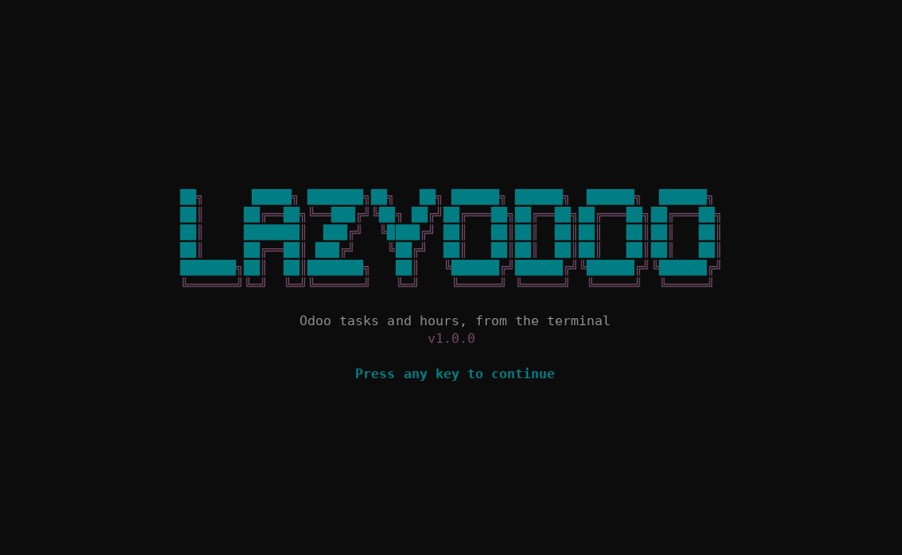

<div align="center">

[English](../../README.md) · [Español](README_es.md) · [Português (Brasil)](README_pt-BR.md) · **简体中文**

# lazyodoo

### 在终端里管理 Odoo 的任务和工时，风格类似 [lazygit](https://github.com/jesseduffield/lazygit) 和 [lazydocker](https://github.com/jesseduffield/lazydocker)。

**一个用 Rust（ratatui）编写的 TUI，通过 JSON-RPC 直接连接 Odoo。中间不需要任何 API：每个人都用自己的 Odoo 用户登录，权限由 Odoo 决定。**

[](#环境要求)
[](#开发)
[](#工作原理)
[](#语言)

[演示](#演示) · [快速开始](#快速开始) · [界面](#界面) · [按键](#按键) · [工作原理](#工作原理) · [出问题时](#出问题时) · [本地数据](#本地数据) · [语言](#语言) · [常见问题](#常见问题) · [开发](#开发)

</div>

> [!NOTE]
> lazyodoo 直接访问 `https://<odoo>/jsonrpc`。你需要 Odoo 数据库的名称，以及你的 Odoo 用户和 API 密钥。

---

用 lazyodoo，你只会看到**分配给你且尚未完成的内容**：你的任务，以及这些任务所在的项目。你可以给任务记录工时、创建任务、修改负责人、阶段、优先级等信息，也可以**完成任务**，让它从列表中消失。首次启动时它会要求填写登录信息，并**在保存前先向 Odoo 验证**。

## 演示

<p align="center"></p>

## 快速开始

### 环境要求

- Odoo 17（社区版或企业版），安装了“项目”和“工时表”应用，不需要额外模块。
- Odoo 数据库的名称。
- 一个 Odoo 内部用户（门户用户会被拒绝）及其 API 密钥。用密码也可以，除非该用户启用了 2FA。
- 编译需要：支持 2024 edition 的稳定版 Rust（1.85 或更高；已用 1.97.1 测试）和 C 编译器（TLS 加密需要）。不需要 OpenSSL：TLS 使用 rustls。

### 安装

克隆仓库，然后在其目录中执行：

```sh
cargo install --path . --locked
```

可执行文件会安装到 `~/.cargo/bin/lazyodoo`。如果不想安装，`cargo build --release` 会把它生成在 `target/release/lazyodoo`。`lazyodoo --version` 会显示版本。

### 运行

```sh
lazyodoo
```

首次启动时会先询问**语言**（英语、西班牙语、葡萄牙语或中文），然后打开登录表单：

| 字段 | 填写内容 |
| --- | --- |
| Odoo 地址 | 只填源地址，例如 `https://odoo.example.com`（不带路径）。必须使用 `https`，`localhost` 除外。 |
| 数据库 | Odoo 数据库的名称 |
| Odoo 用户 | 你的登录名，通常是邮箱（`name@example.com`） |
| Odoo API 密钥 | 你的 API 密钥（建议用它代替密码） |

`Enter` 跳到下一个字段，在最后一个字段上会向 Odoo 验证并保存。如果有问题，提示会告诉你要改什么，并且不会保存任何内容（[查看错误](#出问题时)）。一切正常就会直接进入主界面；以后再启动不会重复询问。

## 界面

打开时会显示 lazyodoo 的横幅；按任意键继续（或稍等片刻）。界面使用 Odoo 的配色，背景沿用你终端的背景色：支持 truecolor（`COLORTERM=truecolor`，或 Windows Terminal）时颜色精确，否则使用最接近的 256 色近似值。

```text
 lazyodoo  name@example.com @ odoo.example.com · 我的 · 项目: 全部
╭ [1] 项目 ───────────╮╭ 详情 ────────────────────────────────────╮
│● 全部               ││#11 迁移数据库                            │
│  Alpha              ││                                          │
╰─────────────────────╯│项目:    Alpha                            │
╭ [2] 任务 ───────────╮│阶段:    进行中                           │
│#11 迁移数据库       ││负责人:  张三                             │
│                     ││工时:    预计 8.0 · 已记录 2.0 · 剩余 6.0 │
╰─────────────────────╯│                                          │
╭ [3] 本周工时 ───────╮│把数据库升级到 v17                        │
│                     ││                                          │
╰─────────────────────╯╰──────────────────────────────────────────╯
 j/k 移动 · t 工时 · n 新建 · e 编辑 · a 指派 · s 阶段 · …
```

- **项目。** 只显示你有未完成任务的项目（按 `m` 会变成全部）。`Enter` 把某个项目作为任务和工时的筛选条件。“全部”会取消筛选。
- **任务。** 左边是列表，右边是详情。默认只显示分配给你且未完成的任务：完成一个任务后它会消失，列表随之上移。
- **工时。** 当前这一周（从周一开始）的工时记录，标题里显示总计。
- 每个面板独立加载：某个面板失败时，错误显示在该面板里，其他面板照常工作。

## 按键

| 按键 | 操作 |
| --- | --- |
| `1` `2` `3` · `Tab` `Shift+Tab` | 切换面板 |
| `j` `k` · `↑` `↓` · `g` `G` | 移动选择，跳到开头或结尾 |
| `J` `K` · `PgDn` `PgUp` | 滚动详情 |
| `Enter` | 在“项目”中：把该项目作为筛选条件 |
| `m` | 在“我的”和“全部”之间切换（两者都只显示未完成的） |
| `/` · `Esc` | 按文字筛选面板 · 清除筛选 |
| `r` | 全部刷新（光标停留在同一条记录上） |
| `l` | 切换语言（在四种语言间循环，并保存） |
| `q` · `Ctrl+C` | 退出 |

在“任务”中，对选中的任务：

| 按键 | 操作 |
| --- | --- |
| `n` | 创建任务 |
| `e` | 在表单中编辑 |
| `a` | 修改负责人（可多选），选择后即保存 |
| `s` | 修改阶段，选择后即保存 |
| `p` | 修改优先级，选择后即保存 |
| `t` | 记录工时 |
| `c` | 完成任务（会要求确认） |

表单占满整个屏幕。文本字段有光标（`←` `→` `Home` `End` `Del`）。在表单中：

| 按键 | 操作 |
| --- | --- |
| `Tab` `Shift+Tab` · `↑` `↓` | 在字段之间移动 |
| `Enter` | 打开字段的选择器，或跳到下一个；在最后一个文本字段上则发送 |
| `Ctrl+S` | 在任意字段上发送 |
| `Backspace` | 删除文字，或清除选择器中的选择（选择器字段带有 `▾`） |
| `Esc` | 取消（发送过程中无法取消） |

在选择器中，输入文字会筛选列表，`Enter` 选择（多选时为勾选/取消勾选），`Esc` 关闭。

## 工作原理

- **连接。** 每个请求都是发往 `<url>/jsonrpc` 的 JSON-RPC `POST`。先用 `common.authenticate` 认证，之后用你的 `uid` 和密钥调用 `execute_kw`。
- **权限。** 只有你的 Odoo 用户本身拥有的权限：lazyodoo 不增加也不减少任何权限。门户用户（`share`）会被拒绝。
- **你是谁。** 通过会话的 `uid` 判断，而不是比较邮箱：“我的”始终可用。你的员工（`hr.employee`）通过你的用户查找，并在 Odoo 中筛选你的工时；如果没有对应员工，则按名字筛选工时。
- **“未完成”的含义。** `state` 不是 `1_done` 也不是 `1_canceled` 的任务。如果你的 Odoo 没有该字段（用 `fields_get` 检查），则使用 `is_closed`；两者都没有时就不筛选。完成任务会在确认后写入 `state = 1_done`（已完成）；确认框会显示该任务及其子任务已记录的工时，与列表中一致（如果你在别处记录过，用 `r` 刷新）。
- **读写范围。** 只涉及下列模型和字段，不提供对 Odoo 的通用访问：

| 用途 | Odoo 模型 |
| --- | --- |
| 用户、项目、阶段和标签 | `res.users`、`project.project`、`project.task.type`、`project.tags` |
| 任务（读取、创建、编辑） | `project.task` |
| 工时（读取、创建） | `account.analytic.line` |
| 你的员工（用于筛选你的工时） | `hr.employee` |

- **编辑。** 只发送有变化的内容；清空可选字段会在 Odoo 中将其清空。表单没有任何变化时，不会发出请求。
- **校验。** 发送前会应用表单和 `routes` 的限制：名称 1 到 256 个字符，工时大于 0 且不超过 24，日期格式 `DD-MM-YY`，预计工时不能为负，id 有效，且只能使用允许列表中的字段。
- **日期。** 以 `DD-MM-YY` 输入：只接受数字，连字符自动补上，也无法拼出不可能的日期（月份大于 12、2 月 31 日……）。记录工时时不接受未来的日期，也不接受晚于今年的年份；截止日期没有年份上限。也可以粘贴 `05/11/2026`。截止日期按你的本地时间填写，以 UTC 保存，这正是 Odoo 期望的方式。
- **开始时间。** 工时表单会询问日期、开始时间（`HH:MM`，冒号自动补上）、工时和描述：这样你就能记录昨天 10:00 做的事，而不是你记录时的时间。开始时间保存在工时记录的 `date_time` 字段中，并显示在“工时”面板和详情里。只有你的 Odoo 有该字段（用 `fields_get` 检测）时才会出现；否则表单会提示，并且不再询问。日期和开始时间都不能是未来。
- **完成任务。** 工时表单以 `完成任务？ [ ]` 结尾（用 `空格` 勾选）。勾选后会先记录工时，再完成任务（已完成），效果与 `c` 相同。如果工时已保存但任务无法完成，提示会说明，并且 `Enter` 只重试“完成任务”这一步。
- **写入。** 绝不会自动重试。遇到超时或 5xx 错误时，提示会说明**可能已经保存**，并让你重试前先检查对应面板。
- **安全。** 必须使用 `https`（`localhost` 除外），不跟随重定向，来自 Odoo 的文本在绘制前会清除控制字符。密钥不会显示在屏幕上，也不会出现在错误信息里。

## 出问题时

提示会以你选择的语言显示。以下是中文的提示：

| 提示 | 原因和解决办法 |
| --- | --- |
| “Odoo 用户、密钥或数据库无效” | 检查登录名、API 密钥和数据库名称。 |
| “Odoo 返回 502：… database "x" does not exist” | 数据库名称有误。 |
| “访问被拒绝：只有内部用户才能使用 lazyodoo” | 你的用户是门户用户，需要内部用户。 |
| “访问被拒绝：…”（带 Odoo 的文字） | 你的用户在 Odoo 中没有该操作的权限。 |
| “Odoo 返回 400：…” | Odoo 拒绝了这些数据；提示内容来自 Odoo。修改表单后重新发送。 |
| “15 秒内没有响应” / “无法连接” | 检查地址和网络连接。 |
| “该地址有响应，但看起来不是 Odoo” | 域名不是 Odoo 的，`/jsonrpc` 路径被屏蔽，或代理切断了请求。 |
| “… 的权限为 644：其他用户可能读到密钥” | 执行提示中给出的 `chmod 600`。 |
| “… 中的配置无效 … 请删除该文件” | 配置文件不完整或已损坏。删除后重新填写。 |
| “无法定位你的用户” / “无法读取你的用户” | 读取你的用户失败：此时显示所有记录。用 `r` 刷新，或检查连接。 |

## 本地数据

lazyodoo 会在配置文件夹中保存两个小文件：

| 文件 | 内容 |
| --- | --- |
| `config.toml` | 你的 Odoo 登录信息，凭据**以明文保存** |
| `settings.toml` | 你选择的语言（不是机密） |

| 系统 | 文件夹 |
| --- | --- |
| Linux | `~/.config/lazyodoo/` |
| Windows | `%APPDATA%\lazyodoo\` |
| macOS | `~/Library/Application Support/lazyodoo/` |

在 Linux 和 macOS 上，文件的权限为 `0600`（文件夹为 `0700`），如果 `config.toml` 的权限更宽松，应用会拒绝启动。在 Windows 上不会调整权限：请用你的用户权限保护该文件夹。要更换服务器或用户，删除 `config.toml`，下次启动会重新询问。要重新选择语言，删除 `settings.toml`（或按 `l`）。

## 语言

英语、西班牙语（`es`）、葡萄牙语（`pt`）和中文（`zh`）。首次启动时，在横幅之后，lazyodoo 会询问使用哪种语言（`↑` `↓` 加 `Enter`，或 `1`–`4`）；选择保存在 `settings.toml` 中。在主界面按 `l` 会切换到下一种语言，并同样保存。

lazyodoo 自己显示的所有内容都已翻译：面板、表单、提示和消息。来自 Odoo 的内容（项目、任务和阶段的名称，以及 Odoo 自己写的错误文字）按 Odoo 发来的原样显示。

## 常见问题

<details>
<summary><strong>它会保存我的 Odoo 密钥吗？</strong></summary>

会，以明文保存在配置文件中，并用 `0600` 权限保护。请使用 Odoo API 密钥而不是密码：它可以单独撤销，不必修改账号密码，即使启用了 2FA 也能用。

</details>

<details>
<summary><strong>我会看到别人的工时，或者看不到自己的工时吗？</strong></summary>

“我的”工时在 Odoo 中按你的员工（与你的用户关联的 `hr.employee`）筛选。如果你的用户没有员工，则按与你的用户同名的员工名筛选；如果也对不上，会出现提示，按 `m` 显示全部。

</details>

<details>
<summary><strong>它会删除数据吗？</strong></summary>

不会。它只读取、创建和修改。

</details>

## 开发

```sh
cargo build
cargo test            # 不需要网络或 Odoo：使用 localhost 上的模拟 Odoo
cargo clippy --all-targets -- -D warnings
cargo fmt --check
```

```text
src/
  main.rs         终端、启动和事件循环
  config.rs       配置、URL 校验、以 0600 权限保存，以及所选语言
  api.rs          应用使用的外观层（get/post/put）和错误
  odoo.rs         JSON-RPC 会话：认证、execute_kw 和 Odoo 错误
  routes.rs       路由、域、字段和序列化
  wizard.rs       首次启动表单
  lang_select.rs  首次启动的语言选择器
  i18n.rs         语言和文本查找（tr/trf）
  ui_strings.rs   四种语言的界面文本
  app.rs          主界面的状态、按键和请求
  ui.rs           面板的绘制
  theme.rs        Odoo 配色（紫色 #714B67、青绿色 #017E84、灰色 #8F8F8F）
  banner.rs       启动横幅
  models.rs       模型，以及列表和详情的文本
  inputs.rs       带光标的文本编辑、自动换行和 DD-MM-YY 日期掩码
  hours_form.rs   记录工时的表单
  create_form.rs  创建和编辑表单，带选择器
  testutil.rs     测试用的模拟 Odoo（仅测试）
```

要添加或修改界面文本，请把英文写进 `tr("…")`（含 `{名称}` 占位符时用 `trf("…", &[…])`），并在 `src/ui_strings.rs` 中加上包含四种语言的一行。如果某条文本缺少某种语言、占位符不一致，或已不再使用，测试就会失败。

## 已知限制

- 不包含线索和联系人，也不能编辑或删除工时记录，不能编辑任务的描述。
- 任务阶段只列出该项目的阶段（前提是你的 Odoo 把它们与项目关联，即 `project_ids`）；否则列出全部。Odoo 可能拒绝不适用的阶段，错误会显示在表单里。
- 开始时间使用 `date_time` 字段。如果你的 Odoo 把工时记录的时间放在别的字段里（可以在开发者模式下把鼠标悬停在字段上查看），表单就不会询问：需要提供技术名称才能加上它。
- 已在 130×36 的终端中测试。更小的终端里布局会被裁剪，但不会出错。
- 在 Linux 上测试，且只针对模拟的 Odoo。未在 Windows 或 macOS 上测试，也未针对真实的 Odoo 17 测试。
